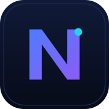

<p align="center">
  
</p>

<p align="center">
  
</p>

<p align="center">
  <a href="https://github.com/agastyatomar/NexLearn/issues"></a>
  
  
  
</p>

<p align="center">
  <b>A free, gamified web app for learning programming.</b>
  <br>Bite-sized lessons. Real code in your browser. XP, streaks, and a community that helps you get unstuck.
</p>

---

## Features

| Feature | Description |
|---------|-------------|
| **Bite-sized lessons** | Complete a lesson in 2–5 minutes. 30-lesson Python-from-Zero curriculum plus a JavaScript track. |
| **Run code in browser** | JavaScript executes in a sandboxed Web Worker. No installs needed. |
| **XP, levels & streaks** | Earn XP per exercise, build daily streaks with freeze protection, level up with badges. |
| **AI doubt helper** | Get unstuck instantly with AI explanations (Groq primary, OpenRouter fallback). |
| **Community threads** | Ask questions per lesson — AI answers first, peers join in. |
| **Leaderboards** | Compete on XP boards. |
| **Mobile-first PWA** | Designed for phones. Installable, offline-tolerant shell. |
| **100% free** | No paywalls, no energy limits. |

## Tech stack

```
Frontend   Next.js 16 (App Router) · React 19 · Tailwind CSS v4
           shadcn-style UI · TypeScript-free JS · Nunito fonts
           Zustand · Monaco Editor · PWA service worker

Backend    Express · Bun + TypeScript (ESM, strict)
           JWT (httpOnly cookies) · bcryptjs · Zod validation
           Helmet · rate limiting · CORS guards

Database   MongoDB · Mongoose

Tooling    Bun 1.3+ (package manager + runtime)
           ESLint (frontend) · tsc --noEmit (backend)
```

## Prerequisites

- [Bun](https://bun.sh) 1.3 or newer (installs deps and runs both apps)
- MongoDB (local `mongod` or a MongoDB Atlas URI)

## Installation

```bash
git clone https://github.com/agastyatomar/NexLearn.git
cd NexLearn

# Install dependencies (frontend & backend)
cd frontend && bun install
cd ../backend && bun install
```

## Environment variables

Both apps need a small env file. Safe examples are included:

```bash
cp backend/.env.example backend/.env
cp frontend/.env.example frontend/.env.local
```

| App | Variable | Purpose |
|-----|----------|---------|
| backend | `MONGODB_URI` | MongoDB connection string (default `mongodb://localhost:27017/nexlearn`) |
| backend | `JWT_SECRET` | Long random string used to sign session cookies |
| backend | `FRONTEND_URL` | Frontend origin for CORS + cookies (default `http://localhost:3000`) |
| frontend | `NEXT_PUBLIC_API_URL` | Backend base URL (default `http://localhost:4000`) |
| frontend | `NEXT_PUBLIC_SITE_URL` | Canonical URL for SEO/OG metadata |

Optional integrations (both apps degrade gracefully when unset): Google sign-in (`GOOGLE_CLIENT_ID`), Appwrite avatar storage, Groq/OpenRouter AI keys. See `backend/.env.example` for the full list.

## Development

```bash
# Terminal 1 — backend on :4000
cd backend && bun dev

# Terminal 2 — frontend on :3000
cd frontend && bun dev
```

Open [http://localhost:3000](http://localhost:3000).

Seed data (curriculum) is loaded from `backend/src/seed/` on first run of the courses flow; validate seed content with `bun run seed:validate` inside `backend/`.

## Build, lint & test

```bash
# Frontend
cd frontend
bun run lint     # ESLint
bun run build    # production Next.js build

# Backend
cd backend
bun run lint     # tsc --noEmit (type check)
bun run build    # tsc emit check
```

> There is currently no automated unit-test suite in this project; lint + type check + production build are the verification gates.

## Deployment

- **Frontend**: deploy `frontend/` to Vercel (or any Node host). Set `NEXT_PUBLIC_SITE_URL` and `NEXT_PUBLIC_API_URL`.
- **Backend**: deploy `backend/` to any Bun-capable host (Render, Railway, Fly.io). Set `MONGODB_URI`, `JWT_SECRET`, `FRONTEND_URL`, and `COOKIE_DOMAIN` if cookies must span domains.
- **Database**: MongoDB Atlas free tier works out of the box.

## Project structure

```
NexLearn/
├── frontend/                 # Next.js 16 App Router
│   ├── app/                  # Routes: landing, (auth), onboarding, app shell, docs, legal
│   ├── components/           # landing/, auth/, app/, lesson/, exercises/, community/, ui/
│   ├── lib/                  # api client, auth helper, code runner, progress DB
│   ├── stores/               # Zustand progress store
│   ├── workers/              # sandboxed JS runner
│   └── public/               # icons, sounds, PWA manifest, service worker
├── backend/                  # Express API (Bun + TypeScript)
│   └── src/
│       ├── routes/           # auth, courses, lessons, progress, community, ai, users…
│       ├── models/           # User, Course, Unit, Lesson, Exercise, Progress, XPEvent…
│       ├── middleware/       # JWT auth, DB guard
│       ├── validators/       # Zod schemas
│       └── seed/             # curriculum seed content
├── docs.md                   # Full API/data-model documentation
├── PRD.md                    # Product requirements
└── DESIGN.md                 # Visual design system
```

## Contributing

1. Fork the project
2. Create your feature branch (`git checkout -b feature/AmazingFeature`)
3. Commit your changes (`git commit -m 'Add AmazingFeature'`)
4. Push to the branch (`git push origin feature/AmazingFeature`)
5. Open a Pull Request

## Security

- Never commit `.env` files — both `.gitignore`s exclude them, and `.env.example` files contain placeholders only.
- Auth uses httpOnly cookies signed with `JWT_SECRET`; pick a long random secret and rotate it if exposed.
- Report vulnerabilities privately via GitHub Security Advisories on this repository.

## License & attribution

This project is a rebranded fork of **Codingo** by [Ayush (@user-synax)](https://github.com/user-synax). The upstream project declares the MIT License in its README; this fork retains full attribution to the original author.

> **Note:** The upstream repository does not currently include a `LICENSE` file in its tree. If you redistribute this project, obtain the upstream license file or written permission from the original author.

Upstream repository: <https://github.com/user-synax/codingo>

---

<p align="center">
  Maintained by <b><a href="https://github.com/agastyatomar">agastyatomar</a></b> · <a href="https://github.com/agastyatomar/NexLearn">View on GitHub</a>
</p>
